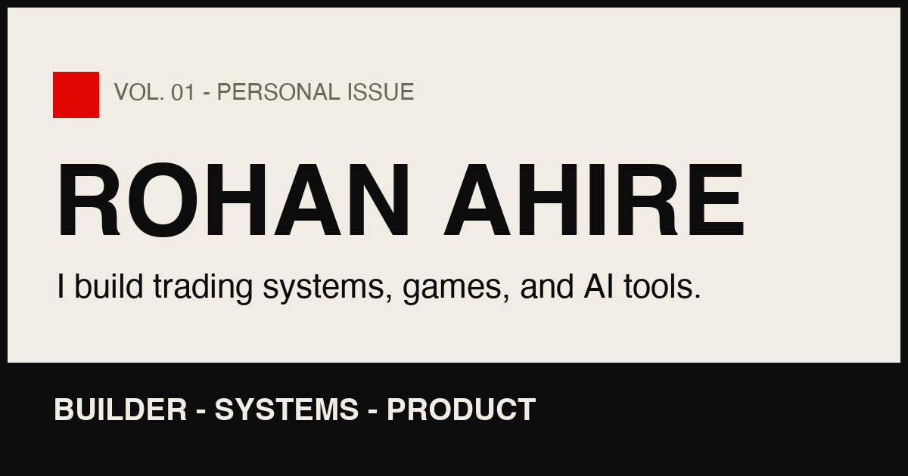

# Rohan Ahire: Portfolio (magazine edition)

A single-page personal portfolio styled like a printed magazine issue, built with Next.js, Tailwind CSS and Framer
Motion.

> This is an earlier version of my personal site. The current site is at [rohanahire.com](https://rohanahire.com).



## What it does

The page presents my projects as a "Vol. 01, personal issue": a hero, a numbered list of project features, an about
section, a stats strip, a "now" ticker and a contact section. Small interactive pieces make it more than a static
résumé page.

## Features

- **Project features with live inserts.** Each project has its own SVG artwork; projects with a deployed app can swap
  the artwork for the running app in an iframe on demand.
- **NSE market clock** in the hero that shows whether the Indian stock market is open, computed in IST.
- **Mini games**: a daily flag quiz and a chess puzzle drawn from FEN strings in print-diagram style.
- **Motion details**: intro wipe, custom cursor, magnetic buttons, scroll progress bar and a marquee ticker, with
  Framer Motion.
- **SEO basics**: metadata, Open Graph image, JSON-LD, `sitemap.ts` and `robots.ts`.
- **All copy in one file**: `src/lib/content.ts` holds the profile, projects, stats and links, so content changes
  never touch components.

## Tech stack

Next.js 16 (App Router) · React 19 · TypeScript · Tailwind CSS v4 · Framer Motion · Fonts: Archivo Black, Newsreader,
Space Mono

## Project structure

```
src/
  app/          layout (metadata, fonts, JSON-LD), page, sitemap, robots, 404
  components/   Hero, Work, LiveInsert, ProjectArt, About, Numbers, Now, Contact, games, motion helpers
  lib/          content.ts (all site copy), useActiveSection
```

## Run locally

Requires Node.js 20+.

```bash
npm install
npm run dev     # http://localhost:3000
npm run build && npm start
npm run lint
```

No environment variables are needed.
